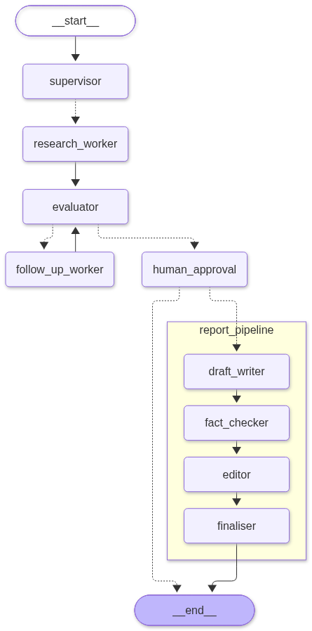

# 🤖 Agentic Research Reporter

A production-grade **multi-agent research and reporting system** built with LangGraph — parallel research agents fan out from a supervisor, findings pass through a human-in-the-loop approval gate, then a modular subgraph drafts, edits, and finalises a polished report. Powered by [OpenRouter](https://openrouter.ai).

---

## 🗺️ Architecture

> Full end-to-end graph — **Main Graph** with the **Report Subgraph** expanded inline.

<p align="center">
  
</p>

<p align="center"><em>Dashed arrows = conditional / dynamic routing. Solid arrows = fixed edges.</em></p>

---

## 📌 Table of Contents

- [How It Works](#-how-it-works)
- [Project Structure](#-project-structure)
- [Quick Start](#-quick-start)
- [Running the Project](#-running-the-project)
- [Key Code Concepts](#-key-code-concepts)
- [Switching LLM Models](#-switching-llm-models)
- [Exercises](#-exercises)
- [Troubleshooting](#-troubleshooting)

---

## ⚙️ How It Works

The system takes a user query and runs it through a full multi-phase pipeline:

| Phase | Node | What it does |
|-------|------|--------------|
| 1 | `supervisor` | Structured breakdown using Pydantic into 3 targeted research tasks with search queries |
| 2 | `research_worker` × N | Runs simultaneously via `Send` API; executes **Tavily MCP Search** and grounds findings with citations |
| 3 | `human_approval` | **Pauses** the graph with `interrupt()` — displays findings preview and verified web source count |
| 4 | `report_pipeline` | **Subgraph**: `draft_writer → editor → finaliser` with preserved citations and compiled reference list |

### States

| State class | Used by |
|-------------|---------|
| `MainState` | Root graph — holds query, tasks, findings, verified sources, approval, and reports |
| `ResearchWorkerState` | Each parallel worker — private state per instance with specific focus and search query |
| `ReportState` | Report subgraph — findings, source references, draft, edited, and final report fields |

### LangGraph Patterns Demonstrated

| Pattern | Where |
|---------|-------|
| `operator.add` reducer | `research_findings` and `sources` — safely merges parallel worker outputs and web citations |
| `Send` API fan-out | `dispatch_workers()` — spawns N workers simultaneously |
| `interrupt()` / `Command(resume=...)` | `human_approval_node()` — HITL gate |
| Compiled subgraph | `report_subgraph` embedded as a node in the main graph |
| `MemorySaver` checkpointer | Persists state across the interrupt/resume lifecycle |
| Model Context Protocol (MCP) | `mcp_server/` — centralized MCP Server hosting research tools |

---

## 📂 Project Structure

```
multi agent system/
├── project_multi_agent.py        # 🏆 Main project (Phase 1: Grounded with MCP Server & Pydantic)
├── mcp_server/                   # 🏰 Central Model Context Protocol (MCP) Server package
│   ├── server.py                 # MCPServer instance & tool registry
│   ├── client.py                 # Dynamic MCP client adapter for LangGraph
│   └── tools/                    # Modular tool definitions
│       ├── tavily_search.py      # Real-time web search tool
│       ├── academic_search.py    # Scholarly (arXiv/Nature) search tool
│       └── web_fetch.py          # Full page content extractor
├── export_graph.py               # Regenerates architecture graph images
├── config.py                     # LLM factory (OpenRouter)
├── requirements.txt
├── .env                          # API keys (OpenRouter & Tavily)
├── assets/                       # Graph images
│   ├── project_multi_agent_combined.png
│   ├── project_multi_agent_graph.png
│   └── report_subgraph.png
└── exercises/                    # 📚 Standalone learning exercises (01–06)
```

---

## ⚡ Quick Start

### 1. Create & Activate Virtual Environment
```powershell
python -m venv venv
.\venv\Scripts\activate
```

### 2. Install Dependencies
```powershell
.\venv\Scripts\pip install -r requirements.txt
```

### 3. Configure API Key
Open `.env` and set:
```env
OPENROUTER_API_KEY=sk-or-v1-your-actual-api-key-here
DEFAULT_MODEL=nvidia/nemotron-3.5-lightning:free
```

### 4. Verify Setup
```powershell
.\venv\Scripts\python config.py
```
Expected:
```
✅  Model : nvidia/nemotron-3.5-lightning:free
   Testing OpenRouter connection …
   Response: OpenRouter OK!
```

---

## ▶️ Running the Project

```powershell
.\venv\Scripts\python project_multi_agent.py
```

**Phase 1** — Supervisor plans tasks, 3 research workers run in parallel, then the graph pauses:
```
============================================================
  ⏸️  HUMAN APPROVAL REQUIRED
  Research complete! Please review the findings before report generation.
  Approve report generation? (yes/no):
```

Type `yes` to resume → the report subgraph runs (`draft_writer → editor → finaliser`) and prints the final report.

Type `no` to abort → graph ends without generating a report.

---

## 🔑 Key Code Concepts

### 1. Parallel Fan-Out with `Send`
```python
from langgraph.types import Send

def dispatch_workers(state: MainState) -> List[Send]:
    return [
        Send("research_worker", {"query": state["query"], "task": task})
        for task in state["research_tasks"]
    ]

builder.add_conditional_edges("supervisor", dispatch_workers, ["research_worker"])
```

### 2. Safe State Merging with `operator.add`
```python
class MainState(TypedDict):
    # Each parallel worker returns a list — operator.add concatenates them
    research_findings: Annotated[List[str], operator.add]
```

### 3. Human-in-the-Loop (`interrupt` / `Command`)
```python
from langgraph.types import interrupt, Command

def human_approval_node(state: MainState) -> dict:
    decision = interrupt({"question": "Approve report generation? (yes/no)"})
    return {"human_approved": decision.lower() in ("yes", "y")}

# Resume from outside the graph:
app.invoke(Command(resume="yes"), config=thread)
```

### 4. Compiled Subgraph
```python
report_builder = StateGraph(ReportState)
report_builder.add_node("draft_writer", draft_writer)
report_builder.add_node("editor", editor_node)
report_builder.add_node("finaliser", finaliser_node)
report_builder.add_edge(START, "draft_writer")
report_builder.add_edge("draft_writer", "editor")
report_builder.add_edge("editor", "finaliser")
report_builder.add_edge("finaliser", END)
report_subgraph = report_builder.compile()

# Used as a node in the main graph:
main_builder.add_node("report_pipeline", report_subgraph)
```

### 5. Checkpointing for HITL
```python
from langgraph.checkpoint.memory import MemorySaver

checkpointer = MemorySaver()
app = main_builder.compile(checkpointer=checkpointer)

# Same thread_id ties Phase 1 and Phase 2 together:
thread = {"configurable": {"thread_id": "research-session-001"}}
app.invoke(initial_state, config=thread)         # Phase 1: runs until interrupt
app.invoke(Command(resume="yes"), config=thread) # Phase 2: resumes from checkpoint
```

---

## 🔄 Switching LLM Models

Update `DEFAULT_MODEL` in `.env`:

```env
# Free models:
DEFAULT_MODEL=nvidia/nemotron-3.5-lightning:free
DEFAULT_MODEL=google/gemini-2.0-flash-exp:free

# Frontier models:
DEFAULT_MODEL=anthropic/claude-3.5-sonnet
DEFAULT_MODEL=openai/gpt-4o-mini
```

---

## 📚 Exercises

The `exercises/` folder contains 6 standalone files that progressively build up the concepts used in the main project:

| File | Concept |
|------|---------|
| `01_hello_langgraph.py` | Basic `StateGraph`, nodes, edges — no LLM needed |
| `02_two_agent_llm.py` | Two-node chain with a real LLM |
| `03_conditional_routing.py` | `add_conditional_edges`, dynamic routing |
| `04_parallel_agents.py` | `Send` API fan-out/fan-in |
| `05_checkpointing.py` | `MemorySaver`, `thread_id`, session isolation |
| `06_supervisor_pattern.py` | LLM supervisor orchestrating workers in a loop |

Run any exercise from the project root:
```powershell
.\venv\Scripts\python exercises\04_parallel_agents.py
```

---

## 🛠️ Troubleshooting

- **`NotFoundResponseError` (model unavailable)**:
  List currently active free models:
  ```powershell
  .\venv\Scripts\python -c "import requests; r = requests.get('https://openrouter.ai/api/v1/models').json(); print([m['id'] for m in r['data'] if ':free' in m['id']])"
  ```
  Pick one and update `DEFAULT_MODEL` in `.env`.

- **Windows UnicodeEncodeError** (emoji in console):
  ```powershell
  $env:PYTHONIOENCODING="utf-8"
  ```

---

## 📜 License

MIT License. Free to use, adapt, and build upon.
